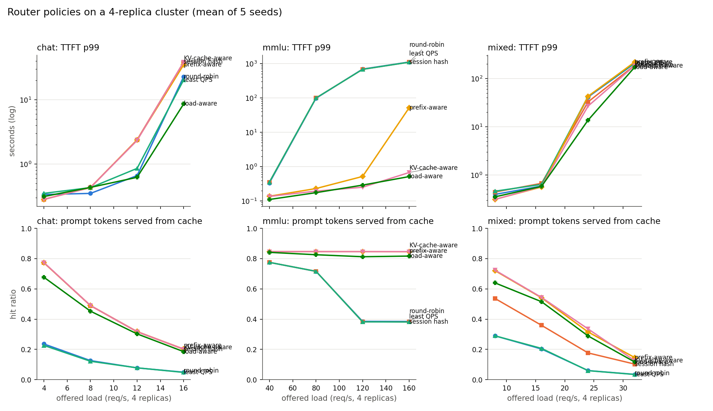
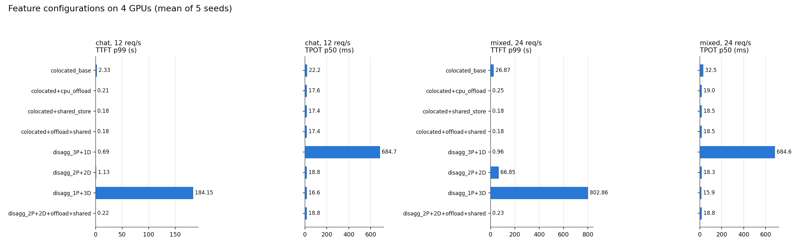
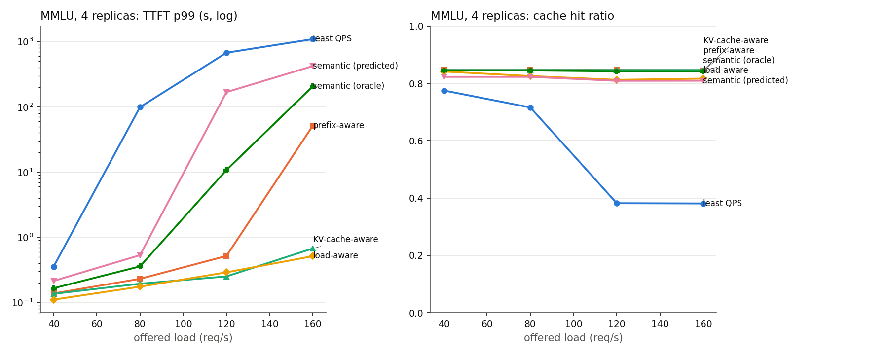

# vLLM production-stack routing & KV-cache experiments (simulated, open data)

Evaluates the routing and KV-cache features of the
[vLLM production-stack](https://docs.vllm.ai/projects/production-stack/en/latest/)
on open-source workloads:

| Feature (production-stack docs) | Where it is modelled | Experiment |
|---|---|---|
| KV-cache-aware routing | `Cluster.route` `kvaware` (max cached prefix) | E1 |
| Load-aware routing | `loadaware` (score = hit fraction − β·relative load, β=1 default) | E1, E1b |
| Prefix-aware routing | `prefix` (128-char chunk trie, as `hashtrie.py`) | E1 |
| Disaggregated prefill | prefill-only replicas → KV transfer → decode replicas | E2 |
| CPU offloading | host-memory KV tier, PCIe reload | E2 |
| Sharing KV cache across instances | cluster-wide shared KV store | E2 |
| Semantic routing | MMLU subject-group classifier → replica pools | E3 |

Routing policy semantics (session hash ring, least-QPS fallback, β default 1.0,
128-char trie) were taken from `vllm-project/production-stack`,
`src/vllm_router/routers/routing_logic.py`.

## Important: these are simulated results, not GPU measurements

The only GPU in the workstation (RTX 4090) was occupied during this work by another
user's training job (`build_heads.py`, ~24 GB of 24.5 GB, 100% utilization). I did
not stop it, so **no vLLM server was run**. Instead, all numbers come from a
calibrated discrete-event simulator (`sim/cluster.py`):

* Per-replica paged KV cache (16-token blocks), refcounted prefix cache, LRU eviction,
  continuous batching with chunked prefill sharing each step with decode.
* Step time is a roofline estimate for an 8B fp16 model on a 4090:
  15 ms weight streaming + 0.13 µs per context token of KV read + prefill at
  6000 tok/s. KV pool 40k tokens (24 GB − 16 GB weights − activations).
* Offload tier: 128k tokens (16 GB host RAM) over 25 GB/s PCIe.
* Shared store: 1M tokens (≈128 GB) over 25 GB/s network with 0.2 ms latency.

**Absolute latencies are assumptions. Relative comparisons between policies are the
meaningful output.** Re-running the same experiments on a free GPU with real vLLM is
the obvious next step (see "Next steps").

## Data (open source)

| Use | Dataset | Size used |
|---|---|---|
| Multi-turn chat with growing history (prefix reuse) | ShareGPT_V3_unfiltered_cleaned_split (`anon8231489123/ShareGPT_Vicuna_unfiltered`) | 1,500 conversations, 7,570 turns, 5.05 turns avg |
| Shared 5-shot prefixes per subject | MMLU `all` (`cais/mmlu`), test split | 13,508 questions, 57 subjects |
| Semantic classifier train / test | MMLU validation+dev (train, 1,816) / test (eval, 13,508) | — |
| Tokenizer (token counts only) | `Qwen/Qwen2.5-0.5B-Instruct` | — |

Tokens are counted with the Qwen tokenizer, not the target model's tokenizer.

Workloads: `chat` (open-loop sessions, 30 s mean think time between turns),
`mmlu` (Poisson requests, 1-token answers), `mixed` (50/50 at the same total rate).
Each run simulates 600 s of arrivals, discards the first 120 s (cold cache), and reports
metrics on the rest. Every configuration runs with **5 seeds**; tables show mean ± std.

## Results

Figures: `results/figures/`. Full tables: `results/tables/`. Raw per-run CSVs:
`results/raw/`.

### E1. Router policies (4 colocated replicas)



Selected rows (TTFT p99 in seconds, cache hit = share of prompt tokens served from cache):

| workload @ req/s | round-robin | least QPS | prefix-aware | KV-cache-aware | load-aware |
|---|---|---|---|---|---|
| chat @ 8 | 0.35 (13%) | 0.43 (12%) | 0.43 (49%) | 0.43 (49%) | 0.43 (45%) |
| chat @ 12 | 0.66 ± 0.42 (8%) | 0.86 ± 0.31 (8%) | 2.36 ± 1.34 (32%) | 2.33 ± 1.25 (32%) | **0.62 ± 0.06** (30%) |
| chat @ 16 | 22.9 (5%) | 20.3 (5%) | 35.0 (20%) | 38.6 (20%) | **8.6** (19%) |
| mixed @ 24 | 41.4 (6%) | 42.9 (6%) | 42.9 (32%) | 26.9 (34%) | **13.7** (29%) |
| mmlu @ 80 | 97 (72%) | 99 (72%) | 0.23 (85%) | 0.19 (85%) | **0.17** (83%) |
| mmlu @ 160 | 1,108 (38%) | 1,095 (38%) | 51.8 (85%) | 0.67 (85%) | **0.51** (82%) |

Findings:

* **Cache-aware placement is the largest single effect.** Round-robin and least-QPS
  reuse 5–13% of chat prompt tokens; KV-aware, prefix-aware and session-hash reuse
  roughly 30–50% at moderate load and 77% at light load. On MMLU, shared subject
  prefixes give 85% hits when routed to the same replica.
* **KV-aware alone degrades under load.** At chat 12 req/s, KV-aware reaches a p99 of
  2.3 s while load-aware holds 0.62 s; at mixed 24 req/s, 26.9 s vs 13.7 s. Load-aware
  is best across the chat and mixed loads we tested, at a modest cost in hit ratio.
* **Prefix-aware is fine until it isn't.** It matches KV-aware on chat, but on MMLU
  it collapses past ~120 req/s (p99 51 s at 160 req/s) because the prefix trie keeps
  sending each subject's prefix to the same replica, which overloads.
* **Load-aware weight β (E1b).** β=0 (pure cache affinity) gives p99 50.8 s on MMLU at
  160 req/s; β=0.25–0.5 gives 0.29–0.30 s. On chat at 12 req/s, β=1 (the production
  default) gives the best p99 (0.62 s). The best β depends on the workload; see
  `results/figures/loadaware_beta.png`.
* **Tie-breaking matters.** The first version of the KV-aware tie-break (by in-flight
  count) was always 0 and so sent every tie to replica 0. With a shared store, all
  replicas tie and the router put 78% of traffic on one replica. Breaking ties by recent
  arrival count (the QPS signal the production router falls back to) fixed it. Any
  deployment that relies on a shared cache has the same failure mode.

### E2. Features on 4 GPUs



| config (4 GPUs) | chat @ 12: TTFT p99 (s) | chat @ 12: hit % | mixed @ 24: TTFT p99 (s) | mixed @ 24: TPOT p50 (ms) |
|---|---|---|---|---|
| colocated, base | 2.33 | 32 | 26.9 | 32.5 |
| colocated + CPU offload | 0.21 | 84 | 0.25 | 19.0 |
| colocated + shared store | 0.18 | 86 | 0.18 | 18.5 |
| colocated + offload + shared | 0.18 | 86 | 0.18 | 18.5 |
| disagg 3P+1D | 0.69 | 29 | 0.96 | 685 |
| disagg 2P+2D | 1.13 | 20 | 66.9 | 18.3 |
| disagg 1P+3D | 184 | 2 | 803 | 16 |
| disagg 2P+2D + offload + shared | 0.22 | 63 | 0.23 | 18.8 |

Findings:

* **CPU offload and the shared store give most of the benefit** in this model, mostly
  by raising the hit ratio from ~32% to ~85%. Their combination adds little over
  either alone. This depends heavily on the capacity assumptions (128k host tokens,
  1M shared tokens), which are generous.
* **Disaggregated prefill trades TTFT for TPOT.** Decode replicas never run prefill,
  so TPOT stays near the 16–19 ms floor. But with 4 GPUs, the split leaves too few
  prefill replicas (1P+3D is far too slow on prefill) or too few decode replicas
  (3P+1D: TPOT p50 685 ms because one decoder saturates). 2P+2D without caches is worse
  on TTFT than colocated with caches. Disaggregation only pays off when combined with
  offload and a shared store.
* In this model, disaggregated prefill does not beat colocated with caching on TTFT at
  any load we tested. Its advantage is TPOT stability under prefill bursts, which
  E2 does not stress enough to show clearly.

### E3. Semantic router

Classifier (TF-IDF + logistic regression, trained on MMLU validation+dev, tested on
the 13,508-question test split): **accuracy 0.777, macro-F1 0.768**, majority baseline
0.309, **0.26 ms per request on one CPU core**
(`results/semantic/classifier_metrics.json`).



Routing MMLU traffic by predicted subject group (one group per replica) on 4 replicas, mean of 5 seeds:

| req/s | KV-aware TTFT p99 | semantic (predicted) TTFT p99 | semantic (oracle labels) TTFT p99 | cache hit, KV-aware / predicted / oracle |
|---|---|---|---|---|
| 40 | 0.14 s | 0.21 s | 0.17 s | 84.7 / 82.3 / 84.5 % |
| 80 | 0.19 s | 0.53 s | 0.36 s | 84.7 / 82.3 / 84.5 % |
| 120 | 0.25 s | 169 s | 10.8 s | 84.6 / 80.9 / 84.2 % |
| 160 | 0.67 s | 423 s | 208 s | 84.7 / 81.0 / 84.2 % |

Findings:

* **Hard group-to-replica pinning is worse than cache-aware routing.** It keeps cache
  hits near the optimum (~84%), but the STEM group (19 of 57 subjects) overloads its
  replica, so TTFT grows far beyond KV-aware routing.
* **Classifier errors cost cache hits and latency.** Predicted labels lose ~3 points of
  hit ratio compared with oracle labels, and at 120 req/s the predicted-label router's
  p99 is ~16× the oracle's (169 s vs 10.8 s).
* **Semantic routing is most useful as a hint, not a hard partition.** Combining a
  predicted group with load-aware scoring is the obvious next thing to test.
* **Not measured:** answer quality or routing to models of different sizes. The vLLM
  Semantic Router's main job is model selection and safety filtering. All replicas
  here serve the same model, so E3 only measures its cache-affinity effect.


### E4. Follow-up: stale KV index (Q2) and soft semantic hint (Q3)

Both run with 5 seeds on the same simulator. Default behaviour (index lag 0, no bonus)
reproduces the E1 numbers exactly (checked: chat @ 12 req/s, KV-aware, seed 0).

**Q2: KV index staleness** (`results/raw/lag.csv`). The controller index refreshes every
`lag` seconds. Requests are still served by the live caches.

| workload @ req/s | lag 0 | lag 0.1 s | lag 0.5 s | lag 2 s |
|---|---|---|---|---|
| chat @ 12, TTFT p99 (s) | 2.33 | 2.33 | 2.32 | 2.27 |
| mixed @ 24, TTFT p99 (s) | 26.9 | 25.6 | 27.5 | 26.1 |
| mmlu @ 120, TTFT p99 (s) | 0.25 | 0.23 | 0.20 | 0.18 |
| mmlu @ 160, TTFT p99 (s) | 0.68 | 0.40 | 0.29 | 77.2 |

Staleness barely changes the hit ratio, which stays at about 0.85 on MMLU. Moderate lag
(0.1–0.5 s) helps MMLU, because stale index entries spread requests across replicas.
Lag of 2 s on MMLU at 160 req/s is unstable (p99 77 s), so that result should be treated
with caution. Most other cells are within the seed noise.

**Q3: soft semantic hint on load-aware routing** (`results/raw/softsem.csv`, MMLU only).
The predicted subject group gets a bonus added to the load-aware score for its
preferred replica.

| req/s | load-aware | + bonus 0.25 | + bonus 0.5 | + bonus 1.0 | hard pinning |
|---|---|---|---|---|---|
| 80, TTFT p99 (s) | 0.175 | 0.165 | **0.160** | 0.214 | 0.53 |
| 120, TTFT p99 (s) | 0.290 | 0.273 | **0.270** | 0.330 | 169 |
| 160, TTFT p99 (s) | 0.514 | 0.505 | **0.495** | 20.6 | 423 |

A soft bonus of 0.25–0.5 gives a small improvement (about 5–9%) over plain load-aware
routing. A bonus of 1.0 lets the predicted group overload one replica, and p99 becomes
unstable at 160 req/s. Hard pinning is far worse. The semantic signal is useful as a
tie-breaker, not as a partition.

## Limitations

* No real vLLM run (GPU occupied; see above). All latencies come from the cost model
  in `sim/cluster.py`. Absolute values are not predictions.
* The KV-aware router reads cache state with zero lag. The production LMCache
  controller has update latency, which would lower hit rates for KV-aware routing.
* Token counts use the Qwen tokenizer; the cost model assumes an 8B fp16 model.
* The shared store and offload capacities are assumptions. Smaller capacities reduce
  the benefit of both tiers.
* No preemption, network congestion, or HTTP/tokenizer overhead.
* Chat think time (30 s mean) is open-loop; there is no feedback from response time to
  the user's next turn.
* Only 5 seeds per configuration; standard deviations are reported, but no significance
  tests were run.

## Reproduce

```bash
python3 -m venv .venv && .venv/bin/pip install -r requirements.txt   # or: uv venv && uv pip install -r requirements.txt
.venv/bin/python data/prepare_data.py          # downloads ShareGPT, MMLU, tokenizer to data/raw (≈700 MB)
.venv/bin/python experiments/semantic_classifier.py
PYTHONHASHSEED=0 .venv/bin/python experiments/run_experiments.py --suite all --seeds 5
.venv/bin/python experiments/make_report.py
```

Layout:

```
data/prepare_data.py          dataset download + workload preparation
sim/workload.py               request streams, block / char prefix hashes
sim/cluster.py                replica cache model, scheduler, routing policies, disaggregation
sim/metrics.py                TTFT / TPOT / hit ratio / SLO / load CV
experiments/semantic_classifier.py   real CPU classifier for the semantic router
experiments/run_experiments.py       suites: routing, beta, features, semantic
experiments/make_report.py           tables and figures
results/raw/*.csv            one row per (config, seed)
results/tables/*.md          aggregated tables
results/figures/*.png        figures
```

## Next steps

1. Run the same configurations with real vLLM + production-stack on a free GPU
   (`helm` chart or the Docker image from the docs), using the same workload files, and
   compare with these simulated numbers to calibrate the cost model.
2. (Done, E4) Controller lag on the KV-aware index: small effect except on MMLU.
3. (Done, E4) Soft semantic hint on load-aware: small gain at bonus 0.25–0.5.
